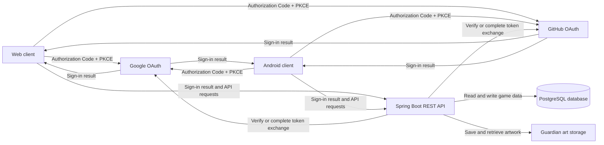
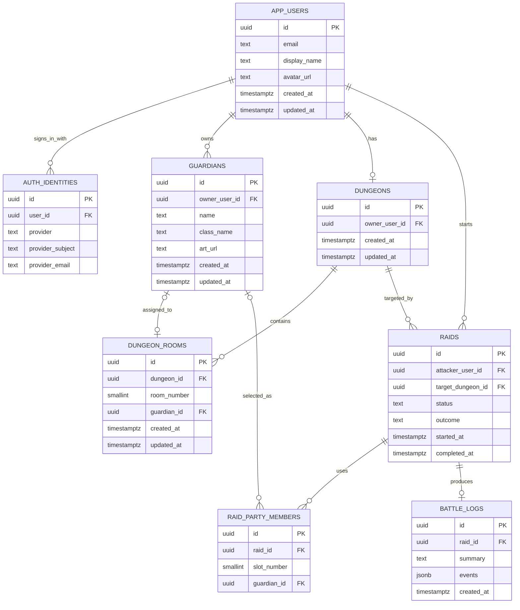

# Doodle Dungeon architecture

## System overview

The API checks the user's access to each requested resource and issues the
app's short-lived token after sign-in. OAuth credentials stay on the server.

## Database ERD

This diagram matches the initial PostgreSQL schema in `database/schema.sql`.

Each user can own multiple guardians and at most one dungeon. A dungeon has
up to three rooms. A raid records its attacker and target dungeon, can use up
to three guardians, and can produce one battle log. The API must verify that
users only access their own resources.